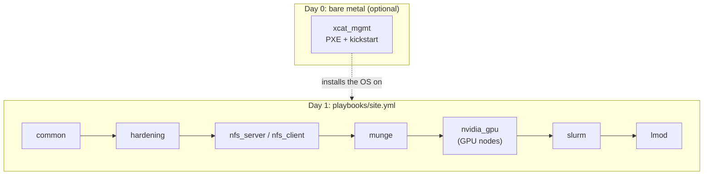

# ansible-hpc-roles

[](https://github.com/Engdarwish2019/ansible-hpc-roles/actions/workflows/ci.yml)


Ansible roles that turn plain EL9 machines (Rocky, AlmaLinux or RHEL 9) into a working Slurm
cluster: shared storage, MUNGE, Slurm with accounting, GPU drivers, environment modules and
security hardening. An `xcat_mgmt` role covers the step before that: provisioning bare-metal
nodes over PXE with xCAT.

The roles pass `ansible-lint` with the **production** profile, and CI renders `slurm.conf` from a
sample inventory to check the node and partition logic.

## Roles

| Role | Purpose |
|---|---|
| [`common`](roles/common) | Hostname, `/etc/hosts`, EPEL + CRB, chrony, SELinux **enforcing**, firewalld with the cluster network in the trusted zone, cluster users with fixed UIDs |
| [`hardening`](roles/hardening) | CIS-inspired and safe for HPC: sshd drop-in, sysctl, auditd rules (identity, sudo, MUNGE and Slurm config), unused filesystems disabled, optional security-only auto updates |
| [`nfs_server`](roles/nfs_server) / [`nfs_client`](roles/nfs_client) | `/shared/home` (rw) and `/shared/apps` (ro) exported to the cluster network only, `root_squash` on |
| [`munge`](roles/munge) | Key generated on the controller and copied to the nodes with `no_log`; never stored in git |
| [`slurm`](roles/slurm) | `slurmctld`, `slurmdbd` on MariaDB (localhost only), `slurmd` in configless mode, cgroup v2 isolation, accounts and users in `sacctmgr`, and a **node health check** (`HealthCheckProgram`) that drains a node whose shared mounts, MUNGE or GPUs fail (ECC errors, row remapping, critical XIDs) and resumes it when they recover |
| [`nvidia_gpu`](roles/nvidia_gpu) | NVIDIA driver from the official CUDA repo, persistence daemon, reboot only when `nouveau` is loaded, `slurmd` ordered after the GPU devices, **DCGM** matched to the driver's CUDA version with a `dcgmi diag` gate before the node takes jobs |
| [`lmod`](roles/lmod) | Lmod with a shared modulefiles tree on `/shared/apps/modulefiles` |
| [`xcat_mgmt`](roles/xcat_mgmt) | xCAT management node: repos, site and network tables, OS image from ISO (`copycds`), node definitions, DNS/DHCP, genesis kernel, `nodeset` |

## How the pieces fit



`slurm.conf` is generated from Ansible facts: sockets, cores, threads and memory come from each
node, partitions come from inventory groups (`slurm_cpu`, `slurm_gpu`), and GPU nodes get
`Gres=gpu:N` from `nvidia_gpu_count`. Compute nodes run in **configless** mode, so only the
controller holds the configuration files.

## Quick start (Vagrant lab)

Requirements: Vagrant with the `vagrant-libvirt` plugin, KVM, Ansible 2.15+.

```bash
ansible-galaxy collection install -r requirements.yml

# 1. Secrets: create and encrypt the vault file (it is git-ignored)
cp inventories/lab/group_vars/all/vault.yml.example inventories/lab/group_vars/all/vault.yml
ansible-vault encrypt inventories/lab/group_vars/all/vault.yml

# 2. Three Rocky 9 VMs: head (controller + NFS), compute-01, compute-02
vagrant up

# 3. Build the cluster
ansible-playbook playbooks/site.yml --ask-vault-pass
```

Then check it:

```bash
vagrant ssh head
sinfo
sudo -iu hpcuser srun -N2 hostname
sacctmgr show assoc format=account,user
```

## Using it on your own nodes

Copy `inventories/lab` and edit `hosts.yml`:

```yaml
slurm_controller:
  hosts:
    head: { ansible_host: 10.1.0.10 }
slurm_compute:
  children:
    slurm_cpu:
      hosts:
        cn[01:16]:
    slurm_gpu:
      hosts:
        gpu01: { ansible_host: 10.1.0.101, nvidia_gpu_count: 4 }
```

Main variables (see each role's `defaults/main.yml` for the rest):

| Variable | Default | Notes |
|---|---|---|
| `cluster_name` | `hpc-lab` | Slurm `ClusterName` |
| `cluster_network` | `192.168.60.0/24` | Trusted in firewalld, allowed in NFS exports |
| `cluster_users` | `hpcuser` (2001) | Same UID/GID everywhere, homes on NFS |
| `slurm_configless` | `true` | Set `false` to copy `slurm.conf` to every node instead |
| `slurm_accounting` | `true` | slurmdbd + MariaDB; needs `slurm_db_password` from the vault |
| `slurm_partitions` | `compute`, `gpu` | Each partition maps to an inventory group |
| `hardening_auto_security_updates` | `false` | Off by default: HPC sites usually patch in maintenance windows |

## Bare-metal provisioning with xCAT

```bash
ansible-playbook -i inventories/lab/xcat.example.yml playbooks/xcat.yml
```

Define nodes in `xcat_mgmt_nodes` (name, MAC, IP), copy the OS ISO to `xcat_mgmt_iso_path`, and set
`xcat_mgmt_provision_nodes: true` to run `nodeset` so the nodes install on their next PXE boot.
xCAT's `makedns` needs SELinux in permissive mode on the management node; that is the only host in
this repository where SELinux is relaxed, and it is controlled by `xcat_mgmt_selinux_permissive`.

## Security notes

- No secrets in the repository: the MUNGE key is generated on the controller, the DB password comes
  from an ansible-vault file that is git-ignored, and secret-handling tasks use `no_log` / `diff: false`.
- SELinux stays enforcing on cluster nodes (`use_nfs_home_dirs` is enabled for NFS homes).
- MariaDB listens on `127.0.0.1` only; `slurmdbd.conf` is `0600` and owned by `slurm`.
- `gitleaks` runs in CI on the full git history.

## CI

| Step | What it checks |
|---|---|
| `yamllint` | YAML style |
| `ansible-lint --profile production` | FQCN, idempotency (`changed_when`), file modes, naming, no free-form commands |
| `ansible-playbook --syntax-check` | Both playbooks |
| `tests/render-slurm-conf.yml` | Renders `slurm.conf` and `gres.conf` from a sample inventory and asserts on node, GPU, partition and health check lines |
| `gitleaks` | Secrets in the git history |

## Related projects

- [slurm-aws-terraform](https://github.com/Engdarwish2019/slurm-aws-terraform): the same cluster on AWS with Terraform.
- [slurm-observability](https://github.com/Engdarwish2019/slurm-observability): monitoring and alerting for it.

## License

MIT
